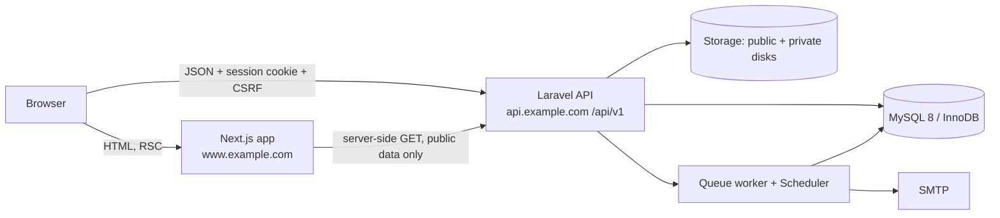

# Architecture

Status: design (Phase 1). Nothing here is implemented yet.

## 1. Overview



- **Next.js** renders UI, validates forms for UX only, and never decides authorization, price, seat availability or payment status.
- **Laravel** is the only component that touches the database and the source of truth for every business rule.
- No microservices. One Laravel app, one MySQL database, a database-backed queue to start.

## 2. Repository layout

Existing frontend stays at the repo root; new directories are siblings:

```
cineora/
├── src/ public/ package.json ...   existing Next.js app (unchanged location)
├── backend/                        Laravel app (Phase 2)
├── docs/
└── README.md
```

Rationale: moving working code is risk without benefit. A later `git mv` into `frontend/` is mechanical if wanted.

## 3. Authentication topology

Sanctum SPA (cookie) mode. Requires frontend and API on the same registrable domain.

- Dev: `http://localhost:3000` ↔ `http://localhost:8000` (same site). `SANCTUM_STATEFUL_DOMAINS=localhost:3000`, `SESSION_DOMAIN=localhost`.
- Prod: `www.example.com` ↔ `api.example.com`, `SESSION_DOMAIN=.example.com`, `SESSION_SECURE_COOKIE=true`, `SESSION_SAME_SITE=lax`, HttpOnly.
- CORS: explicit origin allowlist, `supports_credentials=true`.
- Flow: `GET /sanctum/csrf-cookie` → `POST /api/v1/auth/login` (X-XSRF-TOKEN) → session regenerated → `GET /api/v1/auth/me`.
- Staff and customers share the `users` table; the staff login endpoint additionally requires a staff role and (in production) completed TOTP MFA for privileged roles.
- No bearer tokens in `localStorage`. If a different topology is ever required, that is a documented, separate decision.

**Data-fetching rules in Next.js**
- Public catalogue pages: server components `fetch` the API server-side (no cookies), cached/revalidated per Next 16 caching docs; cache is never used for availability, bookings or anything user-specific.
- Authenticated and interactive pages: client-side calls through one typed API client (`src/lib/api/`) that handles base URL, CSRF init, `credentials: "include"`, error normalisation, 401/419 handling, and `Idempotency-Key` for booking creation.
- `proxy.ts` (Next 16 name for middleware) may redirect unauthenticated `/admin/*` visitors based on a non-secret hint cookie for UX only. Authorization is enforced by the API.

## 4. Backend structure (domain-oriented, not over-split)

```
backend/app/
  Enums/            BookingStatus, PaymentStatus, TicketStatus, ...
  Http/
    Controllers/Api/V1/{Public,Customer,Admin}/...   thin
    Requests/       FormRequests (validation + authorize())
    Resources/      API Resources (explicit field allowlists)
    Middleware/     CorrelationId, ForceJson, SecurityHeaders
  Models/
  Policies/
  Services/         one class per business operation family:
    Booking/        BookingService, SeatInventoryService, SeatHoldService, BookingStateMachine
    Payment/        PaymentSubmissionService, PaymentReviewService, PaymentExceptionService
    Ticket/         TicketIssuanceService, TicketValidationService
    Pricing/        PricingService, PromoService
    Media/          SecureUploadService
    Audit/          AuditLogger
  Jobs/             ExpireBookings, ReleaseExpiredHolds, DetectPaymentExceptions, PublishScheduled, SendNotification, DispatchOutbox
  Events/ Listeners/
```

Controllers: authorize → call one service → return a Resource. Services own transactions.

## 5. API conventions

- Prefix `/api/v1`. JSON only (`ForceJson`).
- Success `{success:true,message,data,meta}`; validation `{success:false,message,errors}` (422); other errors `{success:false,message,code}` with 401/403/404/409/429/5xx. Production 5xx never leak SQL/stack traces; a correlation id is returned in `X-Request-Id` and included in logs.
- Pagination `?page&per_page` (max 100), server-side `filter[...]`, `sort`.
- Public resources use `public_id` (ULID) or slug; internal bigint IDs are never exposed for bookings, payments, tickets, users.
- Booking creation requires `Idempotency-Key`.

## 6. Booking and seat inventory design (core)

**Chosen strategy: materialised per-showtime seat inventory with row locks + unique constraint.**

On showtime creation (or publication) the server inserts one `showtime_seats` row per active seat in the room (status `available`, price snapshot from `showtime_seat_prices` by seat category). This turns "does this seat exist for this showtime" into rows that can be locked.

Create booking (single transaction, `READ COMMITTED` or default `REPEATABLE READ` with `FOR UPDATE`):
1. Idempotency lookup `(user_id, key)`; if found, return the stored booking.
2. Validate showtime is bookable (published, not started, cutoff).
3. `SELECT ... FROM showtime_seats WHERE showtime_id=? AND seat_id IN (...) ORDER BY id FOR UPDATE` (consistent lock order → no deadlocks between overlapping requests).
4. Verify count matches and all are `available` (or `held` with `hold_expires_at < now()` — lazily reclaimed).
5. Price from the locked rows + `PricingService` (fee, promo) — client values ignored.
6. Insert `bookings`, `booking_seats` (price snapshot), `seat_holds`, history rows; update `showtime_seats.status='held'`, `booking_id`.
7. Commit. Final safeguard: `UNIQUE (showtime_id, seat_id)` on active allocations in `booking_seats`/`seat_holds` via a nullable `active_key` generated column pattern (see schema doc).

Expiry job: lock booking row, re-read status, release only if still `PENDING_PAYMENT` and deadline passed; idempotent. A booking with a submitted proof is never auto-released — it moves to `PAYMENT_EXCEPTION` at the deadline.

Timers (config, initial): seat hold 15 min; bank-transfer payment deadline 30 min from booking creation. Deadlines are stored absolute (UTC) and never extended by refresh/resubmission. The hold window protects seats for entering the payment step; submitting a proof before the hold expiry extends protection only up to the payment deadline.

Concurrency tests run against real MySQL (parallel processes), not SQLite.

## 7. State machines

Central `BookingStateMachine` with an explicit allowed-transitions map; payments have their own enum and machine. Each transition checks actor permission, deadlines, payment state and seat allocation validity, then writes `booking_status_histories` and an audit entry in the same transaction. Ticket issuance is only reachable from `PaymentReviewService::verify()` when seats are still validly allocated; otherwise → `PAYMENT_EXCEPTION`.

Allowed booking transitions (initial):
```
PENDING_PAYMENT → PAYMENT_REVIEW | EXPIRED | CANCELLED
PAYMENT_REVIEW  → CONFIRMED | PAYMENT_REJECTED | PAYMENT_EXCEPTION
PAYMENT_REJECTED→ PAYMENT_REVIEW (resubmit, only before deadline) | EXPIRED | CANCELLED
PAYMENT_EXCEPTION → CONFIRMED | CANCELLED | REFUND_PENDING   (admin only)
CONFIRMED       → CANCELLED | REFUND_PENDING
REFUND_PENDING  → PARTIALLY_REFUNDED | REFUNDED | CONFIRMED (refund denied)
```

## 8. Payments, tickets, uploads

- Bank transfer only. Customer submits reference/amount/date + proof image/PDF; stored on the **private** disk with random names; served only through an authorized, short-lived signed endpoint, with `Content-Disposition` and `nosniff`.
- `payment_reviews` is append-only. Verifier cannot be the submitting user. Verification locks payment+booking rows, rechecks state, then issues one ticket per seat.
- Ticket token: 32 random bytes → URL-safe string; only `SHA-256` hash stored; raw token returned only to the owner when rendering. Check-in: `UPDATE tickets SET status='used' ... WHERE id=? AND status='valid'` inside a transaction; affected-rows decides the outcome, so concurrent scans cannot both succeed.
- Uploads: validate by sniffed MIME + image decode/re-encode for images, size limits, random names, no executable types.

## 9. Async work

Database queue + scheduler (every minute): expire bookings/holds, detect payment exceptions, publish scheduled content, dispatch outbox. Notifications use a transactional outbox (`outbox_messages` written in the business transaction, dispatched by a worker); email failure never rolls back a booking.

## 10. Frontend plan

- `src/lib/api/` typed client + endpoint modules + Zod response parsing where useful.
- `src/providers/auth-provider.tsx` (current user via `/auth/me`; UI-only permission hints).
- Existing components keep their markup/styling; data props switch from `@/data/*` to API results. `lib/seats.ts`, `lib/booking-store.ts`, `data/*` are removed once unused (documented in Phase 11).
- Booking flow becomes: pick seats → (login if needed) → `POST /bookings` → payment page (bank details from API, countdown from server `expires_at`) → proof upload → status page → tickets.
- Admin under `src/app/admin/` with its own layout (sidebar, breadcrumbs, theme-aware), permission-aware navigation sourced from `/auth/me` permissions.
- Tests: Vitest + Testing Library for components/API client; Playwright for E2E. (Neither exists today.)

## 11. Caching

Public catalogue (movies, cinemas, content) may be cached with tag-based invalidation on admin writes. Never cached: seat availability, bookings, payments, tickets, any per-user response (`Cache-Control: private, no-store`).
